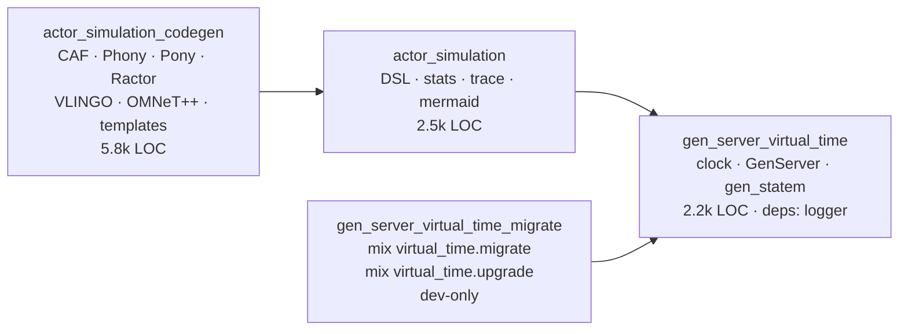

# Plan: split `gen_server_virtual_time` into a family of packages

Status: **every phase closed** — 0, 1, 2 (as a move, without the renames), 4 and
5 landed in 1.0.0; the renames with their shims, the migration and upgrade tasks
and the per-package coverage gate followed in 1.0.1 and 1.1.0 · Target release:
**1.0.0** (published 2026-10-31) · Author: maintainers · Date: 2026-10-31

`gen_server_virtual_time_migrate` (§7.1, `mix virtual_time.migrate`) landed in
1.0.1, and §7.2/§7.3 (the `ActorSimulation.Codegen.*` renames with their
deprecation shims, and `mix virtual_time.upgrade`) in 1.1.0, together with the
per-package coverage gate. What remains open is not work but judgement: the
three questions in §10, which this plan deliberately left to the maintainers.

## 0. Summary of decisions

| Decision              | Choice                                                                                       | Why                                                                                                   |
| --------------------- | -------------------------------------------------------------------------------------------- | ----------------------------------------------------------------------------------------------------- |
| Package count         | 3 runtime packages + 1 dev-only tool package                                                 | Smallest set that separates the three concerns cleanly, without per-generator release churn           |
| Core package name     | stays `gen_server_virtual_time`                                                              | Keeps the Hex page, docs URL, inbound links and search ranking; the name is still accurate            |
| Core scope            | virtual clock + `GenServer`/`gen_statem` wrappers + time backends only                       | ~2.3k LOC, zero runtime deps, nothing to explain before the first test runs                           |
| Module names          | unchanged; new `ActorSimulation.Codegen.*` names added, old ones kept as `@deprecated` shims | The split is a _packaging_ change; users should not have to read a migration guide to get it          |
| Version policy        | all packages share one version, released together from one tag                               | "In sync" by construction; CI enforces it                                                             |
| Migration tool engine | Elixir stdlib only (`Code.string_to_quoted_with_comments/2` + `Code.quoted_to_algebra/2`)    | No third-party dep, aligned with `mix format`, and the formatter is the proof that a rewrite is valid |
| Migration tool        | published as `gen_server_virtual_time_migrate`, dev-only in consumers                        | The core stays small; the tool is usable by everyone and testable in this repo                        |

Nothing in the plan requires an umbrella project. See §5 for the mechanics.

## 1. Goals, non-goals, success criteria

**Goals**

1. Someone who wants "test my GenServer without waiting" adds one dependency and
   reads one page. Today they add a package whose description mentions C++,
   Pony, Go, Rust, Java and OMNeT++.
2. Code generation and simulation stop influencing the core's dependency list,
   compile time and release cadence.
3. Adoption-friendly release: `1.0.0` of the core does **not** force code
   changes — only `mix.exs`.
4. A tested migration path, including a source-rewriting task.

**Non-goals**

- Rewriting the clock or changing its semantics. The clock keeps working exactly
  as it does now.
- Splitting per generator target (six packages) — revisited only if compile time
  or dependency cost becomes a real complaint.
- An umbrella project (§5.3 explains why not).

**Success criteria** (measured 3 months after 1.0.0)

- Core package: `mix hex.info` dependency list is `logger` only; `mix docs`
  builds without the generator pages.
- A scratch project can `Mix.install([{:gen_server_virtual_time, "~> 1.0"}])`
  and run the README's first test in under a minute.
- `mix virtual_time.upgrade --check` reports clean on a project that followed
  the upgrade guide.
- No user reported "module not available" caused by the split in the first
  month.

## 2. Where we are today

`mix.exs` publishes `lib/` of a single project — 11,363 lines across four
unrelated concerns:

| Concern                        | Files                                                                                                                                  | LOC   | Current location    |
| ------------------------------ | -------------------------------------------------------------------------------------------------------------------------------------- | ----- | ------------------- |
| Virtual clock + OTP wrappers   | `virtual_clock.ex`, `time_backend.ex`, `virtual_time_gen_server.ex`, `virtual_time_gen_state_machine.ex`, `gen_server_virtual_time.ex` | 2,280 | `lib/`              |
| Simulation DSL, stats, reports | `actor_simulation.ex`, `actor.ex`, `definition.ex`, `stats.ex`, `mermaid_report_generator.ex`, `generator_metadata.ex`                 | 2,541 | `lib/`              |
| Code generation (6 targets)    | `caf/omnetpp/phony/pony/ractor/vlingo_generator.ex`, `generator_utils.ex`, `template_versions.ex`                                      | 5,834 | `lib/`              |
| Maintainer/demo code           | `dining_philosophers.ex`, `mix/tasks/cover.ex`, `mix/tasks/precommit.ex`                                                               | 708   | `lib/` (published!) |

Three couplings have to be dealt with before anything moves:

1. **Instrumentation was baked into the wrappers — fixed, see §4.1.**
   `VirtualTimeGenServer.Wrapper` and `.call/3` reached into the process
   dictionary (`:__vtgs_stats_enabled__`, `:__vtgs_stats__`,
   `:__vtgs_actor_name__`, `:global_trace_collector`) and exposed
   `:__vtgs_get_stats__` as a protocol between the clock and the simulation.
   That is a _simulation_ concern living inside the core. It was also subtly
   broken: `ActorSimulation.add_process/3` did
   `Process.put(:__vtgs_actor_name__, name)` in the **caller**, while the
   wrapper read it in the **server** process.
2. **The core's version comes from `Mix.Project.config()`**
   (`GenServerVirtualTime.version/0`), which at runtime returns the _consumer's_
   version, and `PonyGenerator` embeds that value into generated projects.
3. **`use VirtualTimeGenServer` ignores its options** (`__using__/1` matches
   `_opts`), so `use GenServer, restart: :transient` cannot be migrated
   mechanically today — the option would be silently dropped.

## 3. Target shape



### 3.1 Module ownership

| Package (Hex / app)                                                    | Modules                                                                                                                                                                                                                                               | Deps                                              | Published |
| ---------------------------------------------------------------------- | ----------------------------------------------------------------------------------------------------------------------------------------------------------------------------------------------------------------------------------------------------- | ------------------------------------------------- | --------- |
| `gen_server_virtual_time` (`:gen_server_virtual_time`)                 | `VirtualClock`, `VirtualClock.VirtualScheduler`, `TimeBackend`, `RealTimeBackend`, `VirtualTimeBackend`, `VirtualTimeGenServer`, `.Wrapper`, `.Instrumentation`, `VirtualTimeGenStateMachine`, `.Wrapper`, `GenServerVirtualTime` (deprecated facade) | `:logger`                                         | yes       |
| `actor_simulation` (`:actor_simulation`)                               | `ActorSimulation`, `.Actor`, `.Definition`, `.Stats`, `.MermaidReportGenerator`, `.GeneratorMetadata`, `.Observer`                                                                                                                                    | `gen_server_virtual_time`                         | yes       |
| `actor_simulation_codegen` (`:actor_simulation_codegen`)               | `ActorSimulation.Codegen.{CAF, Phony, Pony, Ractor, Vlingo, OMNeTpp, Utils, TemplateVersions}` + deprecated shims `ActorSimulation.{CAFGenerator, PhonyGenerator, …}`; `mix actor_simulation.upgrade` (template versions)                             | `actor_simulation`, `:inets`, `:ssl` (tasks only) | yes       |
| `gen_server_virtual_time_migrate` (`:gen_server_virtual_time_migrate`) | `Mix.Tasks.VirtualTime.Migrate`, `.Upgrade`, `VirtualTimeMigrate.*`                                                                                                                                                                                   | `gen_server_virtual_time` (dev)                   | yes       |

Notes:

- `ActorSimulation.GeneratorMetadata` sounds like codegen but is provenance for
  HTML reports; it goes to `actor_simulation`. Keeping the name avoids a
  pointless rename.
- `mix templates.upgrade` becomes `mix actor_simulation.upgrade` (old name kept
  as an alias task) and lives in the codegen package, so `:inets`/`:ssl` never
  enter the core.
- `DiningPhilosophers` moves to `packages/actor_simulation/test/support/`.
  `Mix.Tasks.Cover` / `Mix.Tasks.Precommit` move to `dev/` in the core package
  (they leave the published set — intentional).
- `VirtualClock` stays in the core package for now. Extracting it later
  (`virtual_clock` package, name is free on Hex) is a _non-breaking_ follow-up:
  the module name does not change, users only add a dependency. Do not do it in
  1.0.

### 3.2 What is genuinely breaking in 1.0.0

1. `ActorSimulation*` no longer comes from `gen_server_virtual_time` — add
   `{:actor_simulation, "~> 1.0"}`. `mix virtual_time.doctor` says so, with the
   file and line that need it.
2. `ActorSimulation.{CAF,Phony,Pony,Ractor,Vlingo,OMNeTpp}Generator` and
   `.TemplateVersions` warn as deprecated; canonical names are
   `ActorSimulation.Codegen.*` (removal in 2.0).
3. Simulation statistics/tracing moved from process-dictionary hooks to the
   `VirtualTimeGenServer.Instrumentation` behaviour (§4.1, landed).
4. `Mix.Tasks.Cover` and `Mix.Tasks.Precommit` are no longer shipped;
   `DiningPhilosophers` is no longer shipped.
5. `GenServerVirtualTime.version/0` returns the library version it always should
   have (compile-time), not the caller's project version.

Everything else — `VirtualClock`, `VirtualTimeGenServer`,
`VirtualTimeGenStateMachine`, `TimeBackend` and friends — keeps its name and
behaviour. That is the headline of the release.

## 4. Prerequisite refactor — **landed**

The instrumentation port is implemented:
`lib/virtual_time_gen_server/instrumentation.ex` (the behaviour), the wrapper's
observer hooks, `VirtualTimeGenServer.instrument/1` and `snapshot/1`, and
`lib/actor_simulation/observer.ex` for the numbers a simulation reports.
`test/instrumentation_test.exs` specifies the port;
`test/process_in_loop_test.exs` holds `ActorSimulation` to it.

Do this **before** moving files; it is the only real design work and it must be
reviewed on its own.

### 4.1 `VirtualTimeGenServer.Instrumentation` — as implemented

```elixir
defmodule VirtualTimeGenServer.Instrumentation do
  @callback on_receive(event, meta) :: :ok   # in the observed server, before its callback
  @callback on_send(event, meta) :: :ok      # in the sending process, before the message leaves
  @callback snapshot(context) :: term        # in the observed server, on demand
end
```

Installed per process, never globally:

| Where               | How                                                       | Effect                                                                                                                      |
| ------------------- | --------------------------------------------------------- | --------------------------------------------------------------------------------------------------------------------------- |
| Observed server     | `start_link(..., instrumentation: Mod \| {Mod, context})` | `on_receive/2` for each message, and `on_send/2` for messages the server sends through `call/3`/`cast/2`                    |
| Sending process     | `VirtualTimeGenServer.instrument(Mod \| {Mod, context})`  | `on_send/2` for messages it sends through `call/3`/`cast/2`; `instrument(nil)` stops                                        |
| Anyone with the pid | `VirtualTimeGenServer.snapshot(server)`                   | runs the observer's `snapshot/1` in the server process, returns its term as `{:ok, term}`, or `{:error, :not_instrumented}` |

Decisions taken while implementing:

- **The library's own traffic is invisible.** The wrapper answers `snapshot/1`
  before the observer is told anything, so reading statistics cannot change them
  — without this, `ActorSimulation`'s "read until the totals settle" loop would
  never settle.
- **The observed message, not the transport.** A clock delivery arrives as
  `{:info, the_message}`; `{:__vtgs_delivered__, token, msg}` never reaches an
  observer.
- **No `rescue` around observers.** An observer that raises raises in the
  process running it (documented on the behaviour). Swallowing it would hide the
  bug, and the library is not in the business of guessing which observer errors
  are benign.
- **`ActorSimulation.Observer` counts in the process it observes**, keeping the
  counters under its own key. That is the shape of the library state that
  legitimately belongs to the simulation, and it is not visible to the core.
- **Removed, not deprecated**: `enable_stats_tracking/0,2`,
  `get_process_stats/0`, `generate_incoming_trace_event/2`,
  `set_global_trace_collector/1,3`, `get_global_trace_collector/0`, the
  `:stats_enabled` start option and the `:__vtgs_*` keys. Keeping them would
  have meant keeping a counter implementation in the core, which is the coupling
  being removed. `enable_stats_tracking` and `generate_incoming_trace_event` had
  no callers outside `ActorSimulation`; the global trace collector had none at
  all.

Tests: `test/instrumentation_test.exs` (order of events, scheduled messages, the
library's query being invisible, the server process running the observer, opaque
terms passed through, uninstrumented servers, send-side instrumentation and its
removal, spec normalization) and a new `process_in_loop_test.exs` case that a
real server's statistics come from its observer.

### 4.2 Still to do in this phase

- `VirtualTimeGenServer.__using__(opts)` forwards `opts` to
  `GenServer.__using__` (needed by §7.1).
- `version/0` becomes compile-time (`@version Mix.Project.config()[:version]`).

Exit criteria: `mix test`, `mix test --only slow`,
`mix test --only diagram_generation`, `mix format --check-formatted`,
`mix credo --strict`, `mix dialyzer`, `mix docs` green; published as 0.7.0 with
a CHANGELOG "no action required" note.

## 5. Repository mechanics

### 5.1 Layout

```
/
  VERSION                     # 1.0.0 — single source of truth, checked by CI
  mix.exs                     # workspace-only project: aliases, no app, no deps
  packages/
    gen_server_virtual_time/  # lib, test, dev, mix.exs, README.md, CHANGELOG.md
    actor_simulation/
    actor_simulation_codegen/
    gen_server_virtual_time_migrate/
  examples/                   # Mix.install scripts, now naming the family
  generated/                  # regenerated artefacts (docs site input)
  scripts/                    # test.sh, bump_version.sh, verify_packaging.sh, …
  docs/                       # design notes + this plan + upgrade guide
```

The root `mix.exs` stays a Mix project with `aliases` only, e.g. `mix test.all`,
`mix format.all`, `mix versions.check`. It declares no `:app` and no deps, so
`mix compile` there is a no-op and nothing can silently depend on the workspace.

### 5.2 Sibling dependencies without breaking publishing

Hex drops non-Hex dependencies from published metadata ("non-Hex dependencies
will not be used during dependency resolution and neither will they be listed as
dependencies of the package"). So a published package must declare a plain
version requirement, while day-to-day work must use the sibling sources. One
helper, duplicated in each `mix.exs` (10 lines; a shared file would have to be
packaged, and `mix.exs` is evaluated in isolation):

```elixir
@version "1.0.0"

defp deps do
  [{:gen_server_virtual_time, "~> #{@version}", path: sibling(:gen_server_virtual_time)}]
end

# Inside this repo the sibling directory exists and wins. Inside a consumer's
# deps/ tree it does not, so the version requirement resolves from Hex.
defp sibling(app) do
  path = Path.expand("../../#{app}", __DIR__)
  if File.dir?(Path.join(path, "lib")), do: path, else: nil
end
```

`{:dep, "~> 1.0", path: nil}` is a valid dependency spec, and `Mix.Dep` ignores
a nil path. The residual risk — a consumer having an unrelated
`../gen_server_virtual_time` next to the package — is what §5.4 catches.

### 5.3 Why not an umbrella

Umbrella children depend on siblings with `in_umbrella: true`, which is not
publishable, and umbrella children share the parent's `_build`/config — fine for
apps, wrong for independently versioned libraries. Flat sibling directories with
explicit sibling deps are what Elixir's own multi-package repos do, and they
keep `mix hex.build` semantics obvious.

### 5.4 Version sync and release

- `VERSION` at the root, plus a literal `@version` in each `mix.exs`.
- `scripts/bump_version.sh <major|minor|patch|rc|release>` writes all five
  places, the README pins, and the CHANGELOG heading.
- `mix versions.check` (root alias) fails if: any `@version` differs from
  `VERSION`, or `VERSION` differs from the `v*` tag being built.
- `.github/workflows/publish.yml` publishes in dependency order — core →
  simulation → codegen → migrate — each with
  `source_url: ".../tree/v<version>/packages/<pkg>"` so ExDoc "View source"
  links point into the monorepo. Publishing all four on every tag keeps the
  invariant trivially true; the workflow skips a package whose version is
  already on Hex (`mix hex.info <pkg> <version>`), so a re-run after a partial
  failure is safe.
- `scripts/verify_packaging.sh` (the load-bearing test, run in CI before
  publishing):
  1. `mix hex.build` each package, `--unpack`, and assert no `path:` dependency
     survived into the package metadata;
  2. publish all four into a **local Hex repository**
     (`mix hex.repo add local file://…`);
  3. create a scratch project (no sibling directories anywhere), add only
     `{:gen_server_virtual_time, "~> x.y.z"}` and then only
     `{:actor_simulation_codegen, "~> x.y.z"}`, run `mix deps.get`, compile with
     `--warnings-as-errors`, and run a two-line smoke test
     (`VirtualClock.advance/2` reaching a tick;
     `ActorSimulation.Codegen.CAF.generate/2` returning files).

  Spike step (half a day, first thing in Phase 4): confirm the local-repository
  round trip works offline and that Hex accepts four packages with the same
  version in one session. If it does not, fall back to (1) plus installing from
  unpacked tarballs through `path:` in the scratch project, and record the gap.

### 5.5 CI changes

| Job         | Change                                                                                                                                                          |
| ----------- | --------------------------------------------------------------------------------------------------------------------------------------------------------------- |
| Test matrix | `working-directory: packages/gen_server_virtual_time`; full Elixir/OTP matrix only for the core, one combination for the other three                            |
| Coverage    | `scripts/coverage_combined.sh` becomes per-package export + merge; thresholds per package (core 70% as today, simulation/codegen 70%, migrate 80%)              |
| Quality     | `mix format --check-formatted`, `credo --strict`, `dialyzer` run per package; a single shared PLT at `priv/plts` (`plt_core_path`) so dialyzer is not 4× slower |
| Packaging   | new: `scripts/verify_packaging.sh`, gated on tags and on PRs touching `packages/*/mix.exs`                                                                      |
| Generators  | generator validation jobs move to `working-directory: packages/actor_simulation_codegen`                                                                        |

## 6. What users see (README, docs, CHANGELOG)

### 6.1 README intro for the core package (draft for 1.0.0)

> ## GenServerVirtualTime
>
> **Test time-based GenServers instantly — no waiting, no flaky timing.**
>
> This is the [RxJS TestScheduler](https://rxjs.dev/api/testing/TestScheduler)
> idea applied to the BEAM: the clock is yours to advance, so a test describes
> the timeline it wants instead of sleeping through it.
>
> > **This release is a breaking change in packaging only.** `VirtualClock`,
> > `VirtualTimeGenServer` and `VirtualTimeGenStateMachine` keep their names and
> > behaviour. The actor-simulation DSL and the code generators moved to their
> > own packages, so the library you add for testing a GenServer no longer
> > carries six code generators. Migration is usually one line in `mix.exs` —
> > see [Upgrading to 1.0](docs/upgrading_to_1_0.md) and run
> > `mix virtual_time.upgrade --check`.
>
> ### The family
>
> | Package                                                                                 | What it is for                                                                  | Add it when                                        |
> | --------------------------------------------------------------------------------------- | ------------------------------------------------------------------------------- | -------------------------------------------------- |
> | **`gen_server_virtual_time`** (this one)                                                | virtual clock, `GenServer`/`gen_statem` wrappers, time backends                 | you test code with timers                          |
> | [`actor_simulation`](https://hexdocs.pm/actor_simulation)                               | actor-system DSL, statistics, sequence diagrams                                 | you model parts of a system talking to each other  |
> | [`actor_simulation_codegen`](https://hexdocs.pm/actor_simulation_codegen)               | generate runnable C++, Go, Pony, Rust, Java, OMNeT++ projects from a simulation | you want the same model in another runtime         |
> | [`gen_server_virtual_time_migrate`](https://hexdocs.pm/gen_server_virtual_time_migrate) | `mix virtual_time.migrate` / `mix virtual_time.upgrade`                         | you are converting an existing codebase (dev-only) |
>
> ### Upgrading from 0.6 / 0.7
>
> ```elixir
> def deps do
>   [
>     {:gen_server_virtual_time, "~> 1.0"},
>     # only if you simulate actor systems:
>     {:actor_simulation, "~> 1.0"},
>     # only if you generate code from simulations:
>     {:actor_simulation_codegen, "~> 1.0"}
>   ]
> end
> ```
>
> Then `mix deps.get` and run your tests. If you used the generators directly,
> `mix virtual_time.upgrade --write` renames the modules for you; the old names
> still work but warn.
>
> ### Start here
>
> (existing quick start, unchanged)

### 6.2 Documents to write

| File                                                              | Content                                                                                          |
| ----------------------------------------------------------------- | ------------------------------------------------------------------------------------------------ |
| `packages/*/README.md`                                            | Each package's own front page, aimed at its one job; the table above reproduced                  |
| `docs/upgrading_to_1_0.md`                                        | The five breaking points from §3.2, each with "symptom → fix"; dep matrix; `--check` usage in CI |
| `CHANGELOG.md` (root) + per package                               | `## [1.0.0]` with a `### Breaking` section that opens with "packaging only"                      |
| `packages/gen_server_virtual_time/lib/gen_server_virtual_time.ex` | Moduledoc rewritten as the family hub with `@moduledoc` cross-links                              |
| `CONTRIBUTING.md`                                                 | "which package does this belong to" decision rule; how to run all tests                          |

`test/documentation_test.exs` already executes README snippets, so it moves into
the core package and keeps the README honest — extend it with a test that the
dependency snippet in the README matches `VERSION`.

## 7. Migration tooling

There are two levels, and the first one needs no extra package:

- **`mix virtual_time.doctor` ships in the core package** (landed, §7.0). It
  reads the project's own module references, and for every module that is not
  available tells the maintainer which package of the family it lives in and the
  `mix.exs` line to add — plus, for calls that were removed, what to write
  instead. That is the answer to "the build broke, now what" without installing
  anything.
- **`gen_server_virtual_time_migrate`** (below) rewrites code, which the doctor
  deliberately does not.

Why the doctor rather than a compile-time message: a dependency cannot add text
to another project's compile error. When `ActorSimulation` is not installed, the
error is Elixir's (`module ActorSimulation is not available`), and nothing we
ship can change it. What we can control is (a) that a module keeps its name, so
the only fix is a dependency, and (b) that one command explains the fix. Both
are true.

Published in `gen_server_virtual_time_migrate`, dev-only by nature
(`{:gen_server_virtual_time_migrate, "~> 1.0", only: :dev}`). Two tasks, both
**report-only by default**.

### 7.0 `mix virtual_time.doctor` — shipped in the core package (landed)

| Flag                      | Meaning                                                   |
| ------------------------- | --------------------------------------------------------- |
| _(none)_                  | Report what the project has to change; exit 0 either way  |
| `--check`                 | Exit 1 when something has to change (CI guard)            |
| `--paths lib,test,config` | Default; files that do not parse are reported and skipped |

What it does: scans the tree for remote calls and struct literals
(`VirtualTimeGenServer.ModuleReferences`), keeps the ones naming a module the
build does not have, and attributes each to its package
(`VirtualTimeGenServer.Packages`) — the most specific module wins, so
`ActorSimulation.CAFGenerator` is codegen while `ActorSimulation` is simulation.
`VirtualTimeGenServer.Doctor` turns that into the report. Availability, not the
declared deps, decides: a package that arrives indirectly is not reported.

The report is deliberately one screen:

```
The code refers to modules this project does not have.

Add to your deps:

    {:actor_simulation, "~> 1.0"}

No code changes are needed — a module keeps its name when it changes
package. Then run `mix deps.get`.

Where they are used:
    lib/my_app/pipeline.ex:12: ActorSimulation.new  →  {:actor_simulation, "~> 1.0"}
```

Tests (`test/doctor_test.exs`, fixtures under `test/fixtures/doctor/`): a remote
call is found with file and line; references are reported in source order; a
file that does not parse is reported while the rest of the tree is read; a
missing module is a finding with the right dependency while an available one is
not; the most specific package wins; a removed call carries its replacement;
`format/1` says "nothing to do" on an empty report and offers each dependency
once; and the task reads a tree end to end.

### 7.1 `mix virtual_time.migrate` — `GenServer` → `VirtualTimeGenServer` (landed in 1.0.1)

What shipped differs from the sketch below in three ways, each for a reason:

- **Token replacement instead of `Code.quoted_to_algebra/2`.** Rewriting the
  quoted form reformats untouched lines, and the point of this task is a diff a
  reviewer reads. Each edit carries the source text it expects at its position
  and is checked against the source before it joins the plan, so a plan cannot
  be applied to text it does not describe.
- **No `--json` and no dirty-tree guard yet.** `--paths` is repeatable rather
  than comma-separated, because a real path may contain a comma — the
  comma-split version silently dropped paths in this very test suite.
- **`@behaviour GenServer` modules are not reported yet**: they keep working,
  and a report line without a rewrite is better added once someone asks for it.

Rule 4 stayed a rewrite (it is the reason to run the task at all); the plan's
open question 3 is answered "keep it", with the safety net that the whole run
aborts before writing if a rewrite would not parse.

| Flag               | Meaning                                                                                                       |
| ------------------ | ------------------------------------------------------------------------------------------------------------- |
| _(none)_           | Report: files scanned, modules convertible, call sites, and every site it would **not** touch with the reason |
| `--write`          | Apply changes                                                                                                 |
| `--check`          | Report-only, exit status 1 if anything would change (CI guard)                                                |
| `--paths lib,test` | Default `lib,test`; never reads `deps/`, `_build/`                                                            |
| `--json`           | Machine-readable report                                                                                       |

Rules, in order:

1. **Parse** every file with `Code.string_to_quoted_with_comments/2`; files that
   fail to parse are reported and skipped.
2. **Discover** modules that `use GenServer` / `use GenStateMachine` /
   `use :gen_statem`, and modules carrying `@behaviour GenServer` (report-only:
   "written by hand").
3. **Rewrite declarations**: `use GenServer` → `use VirtualTimeGenServer`,
   preserving options (works only after §4.2 lands).
4. **Rewrite intra-module time calls**: `Process.send_after(...)` and
   `:erlang.send_after(...)` inside converted modules →
   `VirtualTimeGenServer.send_after/3`; `:timer.sleep`, `Process.sleep` →
   `VirtualTimeGenServer.sleep/1`. Report-only when the module also runs in
   production and the caller has not opted into `use_real_time/0` (the migration
   plan's core promise: same code, both clocks).
5. **Rewrite cross-module calls** — only when the target resolves to a converted
   module: `GenServer.call/cast/stop/reply/start_link/start/child_spec`. Targets
   that are variables, pids, `__MODULE__`, remote modules or unknown → listed as
   "needs a human", never guessed.
6. **Report** a per-file table plus a `git diff --stat`-style summary; `--write`
   refuses to run with a dirty tree unless `--force` (this repo's git
   discipline, extended to the user's repo).

Rewrite mechanics: the quoted form with comments is passed to
`Code.quoted_to_algebra/2` — the same pipeline as `mix format` — so the output
is well-formed and idempotent. A rewrite that changes formatting of untouched
lines is acceptable and expected (the diff shows it); a rewrite that fails
`Code.string_to_quoted!` is a bug and must abort the whole run without writing.

Testing (this is the part the release depends on):

- `test/fixtures/migrate/<case>/{before,after}.ex` golden files covering: plain
  `use GenServer`; `use GenServer, restart: :transient`; a converted module
  calling another converted module; a call to an _unconverted_ module (must
  stay); dynamic target (must be reported, not rewritten); a file with
  `# comments` and `~s`/`~S` sigils; a module already using
  `VirtualTimeGenServer` (no-op).
- Every fixture also asserts: `--write` twice changes nothing the second time;
  `--check` on the `after` file exits 0; the `after` file compiles in a temp
  project together with a stub of the library.
- A property test: for any fixture, `report(before)` describes exactly the set
  of `after`-vs-`before` edits.
- A test asserting `--write` leaves the file byte-identical when the only match
  is inside a string literal or a comment.
- An end-to-end test that runs the task against a copy of this repo's own
  `test/` tree and asserts it never touches files outside the given paths.

### 7.2 `mix virtual_time.upgrade` — the split's renames (landed in 1.1.0)

The six generators are
`ActorSimulation.Codegen.{CAF,OMNeTPP,Phony,Pony,Ractor,Vlingo}` as of 1.1, and
the old names are deprecated shims that forward to them (§7.3).
`mix virtual_time.upgrade` moves a project across, and `mix templates.upgrade`
is now `mix actor_simulation.upgrade` — the old task name forwards with a
message.

Two decisions differ from the sketch:

- **`TemplateVersions` keeps its name.** It lives in `actor_simulation`, and
  `ActorSimulation.GeneratorMetadata` reads it; naming it
  `ActorSimulation.Codegen.*` would put a codegen module in the simulation
  package, and moving the file would make simulation depend on codegen. A rename
  is not worth a dependency cycle.
- **`Mix.install([...])` lists are not rewritten**. The dependency line did not
  change for the generator rename — the modules stayed in the same package — so
  there is nothing to rewrite, and editing a user's `mix.exs` remains out of
  scope.

What the task does rewrite, and only when it can prove it: a fully qualified
`ActorSimulation.CAFGenerator.generate(...)`, and an `alias` plus the bare short
name it introduced in that file, when the name it becomes is free. An alias with
`as:`, a file where the new short name is taken, and a bare name with no alias
are reported, not guessed.

### 7.3 Deprecation shims make the tool optional

Because the old module names keep working for one major version, the tasks are a
convenience, not a prerequisite. That is deliberate: a user who only edits
`mix.exs` gets a green build with warnings; a user who runs
`mix virtual_time.upgrade --write` gets a clean one.

## 8. Execution phases

| Phase | Work                                                                                                                                                                         | Exit criteria                                                                                                    | Effort |
| ----- | ---------------------------------------------------------------------------------------------------------------------------------------------------------------------------- | ---------------------------------------------------------------------------------------------------------------- | ------ |
| 0     | §4 refactor (**done**), publish **0.7.0**                                                                                                                                    | all gates green, CHANGELOG says "no action required"                                                             | 2–3 d  |
| 1     | `packages/` layout, `git mv` (history preserved), per-package `mix.exs`/config/tests, version-sync script, root aliases, CI rework — the move and the split land in one step | each package builds and tests standalone; `mix test.all` green; packaging script green against unpacked tarballs | 3–4 d  |
| 2     | `ActorSimulation.Codegen.*` + deprecation shims + `@deprecated`                                                                                                              | warnings appear exactly where the upgrade guide says they do                                                     | 2 d    |
| 3     | migration tool package + fixtures + golden/property tests                                                                                                                    | `mix virtual_time.migrate --check` clean on this repo                                                            | 3–4 d  |
| 4     | release engineering: local-repo round trip, publish workflow, per-package docs with monorepo `source_url`, coverage merge                                                    | `1.0.0-rc.0` published for all four packages; scratch-project install verified by CI                             | 2 d    |
| 5     | READMEs, upgrade guide, examples, `generated/` regeneration, docs hub                                                                                                        | docs build with 0 warnings per package; README tests green                                                       | 1–2 d  |

Total ≈ 2.5–3 weeks of focused work. Phases 0 and 1 are the only ones that block
everything else.

## 9. Risks

| Risk                                                                                 | Impact | Mitigation                                                                                                                                                                                                                                                                                                                                                   |
| ------------------------------------------------------------------------------------ | ------ | ------------------------------------------------------------------------------------------------------------------------------------------------------------------------------------------------------------------------------------------------------------------------------------------------------------------------------------------------------------ |
| Hex silently drops `path:` deps from metadata → consumers get "module not available" | high   | `scripts/verify_packaging.sh` (§5.4) — the definitive test; it fails the build, not the user's                                                                                                                                                                                                                                                               |
| Local Hex repository round trip does not work the way we assume                      | medium | half-day spike at the start of Phase 4, with the documented fallback                                                                                                                                                                                                                                                                                         |
| Users on `~> 0.6` get a major bump they did not ask for                              | medium | 0.7.0 first (non-breaking), a `### Breaking` section that leads with "packaging only", and `mix virtual_time.upgrade --check` in the guide                                                                                                                                                                                                                   |
| Generator output embeds the library version (`PonyGenerator`)                        | low    | the codegen package reads its own `@version`; regenerate `generated/` and assert in a test                                                                                                                                                                                                                                                                   |
| Four dialyzer PLTs / four test runs slow CI                                          | low    | cache `packages/*/priv/plts` in CI, keyed on `mix.lock` (a PLT describes the toolchain, not our version) — done in 1.1.0. A shared `plt_core_path` was tried and measured: dialyxir rebuilds the Elixir core PLT whenever a package's target PLT is missing, so sharing the directory saved nothing and was reverted. The matrix still runs on the core only |
| Long-lived feature branches conflict during the `git mv`                             | low    | do Phase 1 in one sitting on a quiet day, document the `git blame` follow (`--follow`)                                                                                                                                                                                                                                                                       |
| Docs fragmentation across four hexdocs sites                                         | medium | family table on every README and moduledoc hub; consistent first paragraph structure                                                                                                                                                                                                                                                                         |
| Users copy process-dictionary stats hacks from old blog posts                        | low    | the deprecated wrappers keep working in 1.0 and log a one-time upgrade hint                                                                                                                                                                                                                                                                                  |

## 10. Open questions

1. Should `virtual_clock` be its own package (non-breaking, post-1.0)?
   Recommended: not yet.
2. Is `actor_simulation_codegen` the name we want long-term, or `actor_codegen`?
   (Both free on Hex.)
3. Do we cut `mix virtual_time.migrate`'s rule 4 (rewriting
   `Process.send_after`) to report-only in the first release? It is the riskiest
   rewrite; it may deserve one release of soak time.
